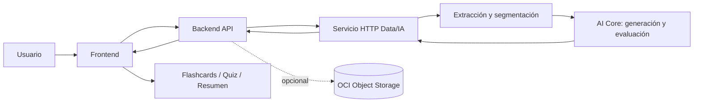

# 🧠 NuevaMente
### Plataforma inteligente para adaptar documentación técnica y convertirla en aprendizaje interactivo

NuevaMente transforma documentos técnicos en materiales de aprendizaje adaptados al perfil del destinatario. El usuario carga un documento, selecciona el perfil y el formato deseado, y obtiene contenido estructurado para estudiar de forma más clara e interactiva.

Proyecto desarrollado por **G10-LATAM — Equipo 15** para el hackathon de **Oracle Next Education (ONE) y Alura Latam**.

---

## 🎯 Problema que resolvemos

La documentación técnica suele ser extensa y difícil de adaptar a personas con diferentes niveles de experiencia. Convertirla manualmente en recursos de estudio requiere tiempo y puede introducir errores o afirmaciones que no aparecen en la fuente.

NuevaMente busca reducir ese esfuerzo mediante generación asistida por IA, estructuras de salida validadas y una evaluación del contenido generado frente al documento de origen.

## ✨ Qué permite hacer el MVP

- **Cargar documentación:** PDF, Markdown y TXT.
- **Adaptar la explicación:** perfiles Junior, Senior y Ejecutivo.
- **Elegir un formato didáctico:**
  - **Flashcards:** tarjetas con frente, dorso y pistas cuando estén disponibles.
  - **Quiz Interactivo:** preguntas de opción múltiple con respuesta y justificación.
  - **Resumen Ejecutivo:** síntesis, puntos clave, impacto y recomendaciones.
- **Evaluar el contenido generado:** el flujo de IA contrasta afirmaciones con fragmentos de la fuente y devuelve una evaluación de calidad.
- **Consultar el estado de almacenamiento:** cuando se configura la integración opcional con OCI Object Storage, Backend informa el estado confirmado de la persistencia.

> La evaluación automática ayuda a detectar contenido insuficientemente sustentado, pero no sustituye la revisión humana. La generación depende de la disponibilidad y las cuotas del proveedor de modelos.

## 🖥️ Demo

- **Aplicación desplegada:** [http://44.198.212.151](http://44.198.212.151)
- **Repositorio:** [G10-LATAM-EQUIPO15](https://github.com/No-Country-simulation/G10-LATAM-EQUIPO15)
- **Documentación de la demo desplegada:** [Despliegue Azure y validaciones](docs/AZURE_TERRAFORM.md)
- **Evidencia de la integración local con OCI:** [Demo local con OCI Object Storage](docs/DEMO_LOCAL_OCI.md)

La URL pública utiliza HTTP, no HTTPS. La disponibilidad del entorno remoto puede cambiar.

## 🧩 Cómo funciona



1. **Frontend:** permite cargar el documento, configurar la adaptación y consultar el resultado.
2. **Backend:** valida las entradas, coordina la solicitud a IA, valida la respuesta y gestiona el estado de almacenamiento.
3. **Data/IA:** extrae y estructura el contenido del documento, genera fragmentos y mantiene registros y cachés persistentes en un volumen Docker.
4. **AI Core:** orquesta la generación estructurada y la evaluación de las afirmaciones frente al contexto disponible.
5. **OCI Object Storage (opcional):** Backend puede guardar el documento original y el JSON generado cuando se habilita y configura el acceso.

La API utiliza el endpoint `POST /api/v1/adaptar-contenido` con `multipart/form-data`. El contrato vigente define los campos de entrada y la respuesta de seis campos.

## 🛠️ Tecnologías principales

| Componente | Tecnologías |
|---|---|
| Frontend | HTML, CSS, JavaScript y Nginx |
| Backend | Python, FastAPI y Pydantic |
| Orquestación de IA | Python y LangGraph |
| Modelos de lenguaje | Google Gemini; respaldo mediante Groq configurable |
| Procesamiento y persistencia de datos | Extracción documental, chunking, cachés y ChromaDB opcional |
| Contenedores | Docker y Docker Compose |
| Infraestructura documentada | Azure con Terraform; OCI Object Storage opcional para persistencia |

Los proveedores y modelos efectivos se controlan mediante variables de entorno. Consulta la documentación de IA antes de cambiar la configuración.

## 🚀 Ejecutar el MVP en local

### Requisitos

- Git
- Docker Desktop o Docker Engine con Docker Compose
- Una clave válida de Google AI Studio para Gemini
- Conexión a Internet para construir las imágenes y realizar llamadas al proveedor de IA

No es necesario instalar Python localmente para utilizar la integración completa por Docker.

### 1. Clonar el repositorio

```powershell
git clone https://github.com/No-Country-simulation/G10-LATAM-EQUIPO15.git
cd G10-LATAM-EQUIPO15
```

### 2. Configurar la clave de IA

Crea el archivo privado `ia/.env` y añade tu propia clave:

```dotenv
GOOGLE_API_KEY=tu_clave_de_google_ai_studio
```

No compartas ni subas este archivo. No introduzcas credenciales reales en el repositorio, capturas, logs o documentación. Puedes consultar `ia/.env.example` como referencia.

### 3. Construir y levantar los servicios

Desde la raíz del repositorio, en PowerShell:

```powershell
docker compose --env-file ia/.env -f compose.integration.yaml up --build -d --wait
```

### 4. Abrir la aplicación

| Servicio | Dirección local |
|---|---|
| Frontend | [http://localhost:18003](http://localhost:18003) |
| Backend — Swagger | [http://localhost:18002/docs](http://localhost:18002/docs) |
| Health del Frontend | [http://localhost:18003/health](http://localhost:18003/health) |

El servicio HTTP de IA está en la red interna de Docker y no necesita exponerse al navegador.

### 5. Detener la aplicación

```powershell
docker compose --env-file ia/.env -f compose.integration.yaml down
```

El comando anterior conserva el volumen de datos. Evita añadir `--volumes` si deseas conservar los registros, vectores y cachés de IA.

Si los puertos están ocupados, consulta [frontend/README.md](frontend/README.md) para configurar puertos alternativos y revisar los límites operativos.

## 🧪 Pruebas y validación

El repositorio contiene pruebas separadas por componente. Para ejecutarlas y comprender qué comprueba cada suite, sigue la guía completa en [tests/README.md](tests/README.md).

### Suite integrada de Frontend y proxy

Desde la raíz del repositorio:

```powershell
docker compose -f compose.frontend.tests.yaml up --build --abort-on-container-exit --exit-code-from tests
docker compose -f compose.frontend.tests.yaml down
```

La suite documentada contiene **52 comprobaciones automatizadas**: 30 unitarias, 15 HTTP del Frontend y 7 del recorrido Nginx → Backend real → IA simulada. No necesita claves de proveedores. Esta cifra corresponde a esta suite, no al total de todas las pruebas del proyecto.

### Integración y proveedor real

La guía de pruebas explica cómo ejecutar las suites de Backend, Data/IA y AI Core, así como el ensayo opcional con Gemini real. Este último consume cuota del proveedor y requiere configurar credenciales propias.

También se encuentran versionadas evidencias de evaluación de calidad, por ejemplo el [resumen de línea base](tests/calidad/resultados/20261021-1327-linea-base/resumen.md). Sus resultados corresponden a esa ejecución y a esos documentos de prueba; no son una garantía de resultados futuros.

**Importante:** las pruebas unitarias, las pruebas HTTP con IA simulada y las adaptaciones con proveedores reales validan aspectos distintos. No deben sumarse ni presentarse como una sola métrica sin verificar que corresponden a conjuntos independientes.

## 📚 Documentación

| Documento | Descripción |
|---|---|
| [Requisitos del producto (PRD)](docs/01_PRD_PRODUCT_REQUIREMENTS_DOCUMENT.md) | Problema, alcance y requisitos del MVP |
| [Arquitectura de IA y sistema multiagente](docs/06_ARQUITECTURA_DE_IA_Y_SISTEMA_MULTIAGENTE.md) | Diseño técnico del procesamiento y de AI Core |
| [Diagramas y flujos](docs/07_DIAGRAMAS_DE_ARQUITECTURA_Y_FLUJOS.md) | Vistas de arquitectura y proceso |
| [Contrato Backend ↔ IA](docs/CONTRATOS/CONTRATO_BACKEND_IA.md) | Contrato de integración vigente |
| [Guía de pruebas](tests/README.md) | Suites, comandos y ensayo real con Gemini |
| [Guía del Frontend](frontend/README.md) | Formularios, resultados, límites y pruebas de interfaz |
| [Guía de Data/IA](ia/README.md) | Ingestión, chunking, cachés, Chroma y servicio HTTP |
| [Integración con OCI Object Storage](docs/OCI_OBJECT_STORAGE.md) | Configuración, estados y límites del almacenamiento |
| [Despliegue con Azure y Terraform](docs/AZURE_TERRAFORM.md) | Infraestructura y validaciones del entorno público |
| [Demo local con OCI](docs/DEMO_LOCAL_OCI.md) | Pasos de demostración y evidencia de almacenamiento |

## 📁 Estructura del repositorio

```text
.
├── backend/                 # API, validaciones e integración con IA
├── frontend/                # Interfaz web y Nginx
├── ia/                      # Data/IA y servicio HTTP
├── nuevamente-ai-core/      # Orquestación y generación de contenido
├── docs/                    # Arquitectura, contratos y despliegue
├── tests/                   # Guías y evidencias de pruebas integradas
├── data/                    # Datos y documentos de prueba
├── infra/                   # Infraestructura como código
├── scripts/                 # Automatización de ejecución y validación
├── compose.integration.yaml # Integración local de los servicios
└── README.md                # Documentación principal
```

## ⚠️ Alcance y consideraciones

- El MVP público ofrece Flashcards, Quiz Interactivo y Resumen Ejecutivo. Otros formatos que aparecen en documentos de diseño pueden corresponder a propuestas o capacidades internas, no al formulario público vigente.
- Los embeddings en Chroma son opcionales en la configuración consolidada; la generación utiliza los fragmentos y registros del documento.
- OCI Object Storage está desactivado por defecto en la integración local. Requiere bucket, configuración y credenciales válidas para habilitarlo.
- La aplicación pública documentada usa HTTP. No introducir datos sensibles en la demo.
- La generación puede tardar varios minutos con documentos nuevos y depende de límites, latencia y disponibilidad del proveedor de IA.
- Una evaluación automática de calidad no reemplaza la validación pedagógica y técnica por una persona.

## 👥 Equipo

Proyecto desarrollado por **G10-LATAM — Equipo 15** en el marco del hackathon de Oracle Next Education (ONE) y Alura Latam.

## 📄 Licencia

No se declara una licencia de código abierto en este README. Antes de reutilizar o redistribuir el software, revisa si el repositorio define una licencia aplicable.
